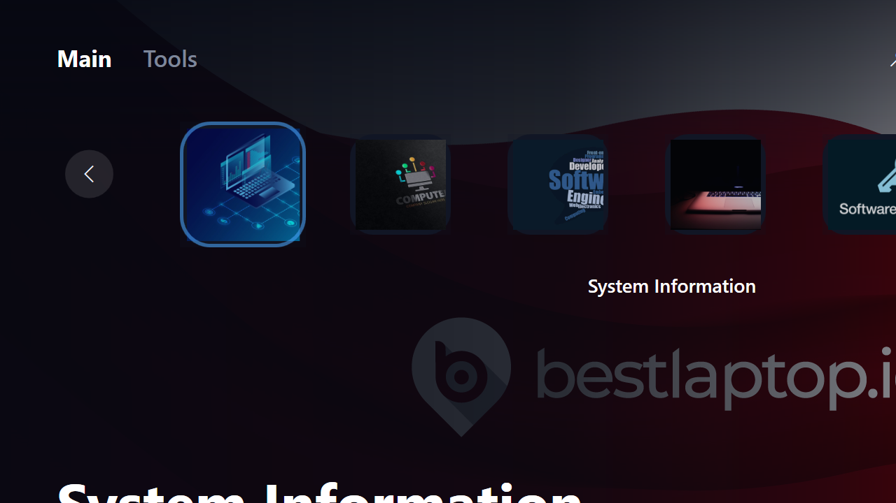

# RyotaQC V5

<div align="center">



**Aplikasi Quality Control & Maintenance untuk teknisi laptop**

Dibangun dengan C# + WPF + MVVM di .NET 10

</div>

---

## Tentang Project

**RyotaQC V5** adalah aplikasi desktop Windows yang dirancang khusus untuk teknisi perbaikan & refurbish laptop. Aplikasi menggabungkan fungsi **diagnostik sistem**, **instalasi driver**, **pusat software offline**, **quality control checklist**, dan **generator laporan PDF/Notepad** dalam satu UI bergaya modern (glassmorphism dark blue, PS5-style tile menu).

Aplikasi ini bekerja **100% offline** — tidak ada koneksi internet, tidak ada authentication, tidak ada telemetry. Semua tool & installer sudah dibundle di dalam folder `tools/`.

## Bahasa & Tech Stack

| Komponen | Teknologi |
|----------|-----------|
| Bahasa utama | **C# 13** (.NET 10) |
| UI Framework | **WPF** (Windows Presentation Foundation) |
| Pattern | **MVVM** (CommunityToolkit.Mvvm 8.4.2) |
| Dependency Injection | Microsoft.Extensions.DependencyInjection 9.0.8 |
| Behavior | Microsoft.Xaml.Behaviors.Wpf 1.1.142 |
| System info | System.Management 10.0.5 (WMI) |
| PDF generator | **QuestPDF** 2025.7.4 |
| Target framework | `net10.0-windows` |
| Target OS | Windows 10/11 x64 |

## Tujuan Project

- **Mempercepat workflow teknisi QC laptop**: dari format → driver install → software install → QC checklist → laporan PDF
- **Konsistensi laporan**: setiap QC menghasilkan laporan PDF dengan format tabel standar (header, checklist warna, summary)
- **Self-contained**: tidak butuh koneksi internet. Semua installer (Chrome, Firefox, VLC, WinRAR, Office, Zoom, TeamViewer, MAS, dll) sudah dibundle
- **Multi-brand support**: otomatis deteksi Lenovo / Dell / HP untuk Driver Pack yang sesuai
- **Touchscreen test**: 12×8 grid fullscreen dengan tap counting & ghost touch detection

## Fitur Utama

### 1. Main Menu (Dashboard)
UI utama dengan tile bergaya PS5 — wallpaper dinamis per menu, transisi fade smooth, navigasi keyboard (arrow + Enter) atau click/touch langsung.

### 2. System Information
Informasi real 100% dari WMI: CPU, OS, RAM, Storage, GPU, disk partitions, account name, LCD info, refresh data, dengan ikon kontekstual per kategori.

### 3. Driver Pack
Launcher driver pack sesuai brand:
- **Dell** → .NET SDK 10 + Dell Command Update
- **Lenovo** → Lenovo System Update
- **HP** → HP Support Assistant
- Plus tools: Update Windows, Disable/Enable Windows Update, Optional Update, Retry Download, HP Brightness Fix

### 4. Software Center
Pusat instalasi aplikasi:
- **Online Apps**: launcher aplikasi web (Chrome, Firefox, VLC, WinRAR, Zoom, TeamViewer, Canva)
- **Offline Installer**: installer offline dengan checkbox selection (warna hijau saat dipilih), panel kanan rapi, install selected atau install all
- **Microsoft Office**: Setup.exe offline dengan deskripsi yang jelas

Setelah install, otomatis buat shortcut di desktop kalau executable ketemu (Chrome, Firefox, VLC, dll). Shortcut palsu Control Panel **dihilangkan** — kalau executable asli tidak ketemu, tidak bikin shortcut palsu.

### 5. Wallpaper
Pilih wallpaper desktop standar RyotaQC, scroll compact, preview thumbnail kecil, klik → set wallpaper langsung.

### 6. Software Licensing (MAS)
Langsung membuka `tools/MAS_AIO.cmd` (761 KB, MAS activation script) sebagai administrator. Window cmd **tetap terbuka** setelah selesai (cmd `/k`), dan dibawa ke **foreground** supaya tidak tertutup app fullscreen.

### 7. Quick Launcher
Akses cepat ke tool Windows yang sering dipakai: Disk Management, User Accounts, Wallpaper changer. Termasuk info LCD real, dan deteksi brand untuk auto-suggest driver pack.

### 8. Quality Control (Halaman Inti)
Checklist QC lengkap dengan **popup system** untuk semua test:

| Kategori | Test Method |
|----------|-------------|
| LCD | Visual test (warna full screen) + popup result |
| Storage Health | Manual % input popup (warna: 0-50% merah, 60-70% kuning, 70-100% hijau) |
| Battery Health | Battery info tool + popup warna threshold |
| Battery Report | `powercfg /batteryreport` |
| Keyboard | Visual + popup result |
| Audio | Play test sound + popup |
| Benchmark | CrystalDiskMark + popup result |
| Running Test | VLC `--fullscreen --loop --hwdec=auto --no-video-title-show` (WMP fallback, prevent sleep via `SetThreadExecutionState`). Duration diinput via popup time `Jam:Menit` |
| Touchscreen | **12×8 grid fullscreen**, tap counting, ghost touch detection (>1 tap → kuning), auto-complete "Test Done Bang Aman" |
| Touchpad | Fullscreen test |
| Port | Cek port fisik + popup result |
| WiFi | Deteksi WiFi connected + popup |
| Camera | Test camera + popup |
| Backlight | Test brightness + popup |
| Mic | Test microphone + popup |

**Hasil test popup** dengan 3 tombol:
- **OK** (hijau) → PASS
- **-** (abu) → SKIP
- **X** (merah) → input catatan kegagalan

**Catatan Otomatis** terisi mengikuti urutan checklist, dengan field:
- `Kode Unit = ` (manual)
- `Tanggal Test = ` (auto dari waktu mulai QC)
- `Model Laptop = ` (auto untuk Dell/HP dari System Model WMI; manual untuk Thinkpad/Asus yang System Model-nya kode acak seperti `20NMS23S0L`)

### 9. Report (PDF + Notepad)
**Hasil QC popup** berisi:
- Tombol **Save PDF** → QuestPDF generated A4 portrait, 1 halaman:
  - Header: "RYOTAQC V / QUALITY ASSURANCE"
  - Info grid 3×2: MODEL SYSTEM, SERIAL NUMBER, TANGGAL TEST, GENERATED, KODE UNIT, MODEL LAPTOP
  - Tabel checklist 5 kolom: KATEGORI QC | PASS | — | FAIL | CATATAN
  - Baris PASS → background hijau muda + ✓ hijau
  - Baris FAIL → background merah muda + ✓ merah + catatan
  - Baris SKIP → background putih + — abu
  - Running Test → tampilkan "Durasi: XJ YM" di kolom Catatan
  - Summary bar (PASS count, BELUM count, FAIL count)
  - Footer: "Dibuat oleh IllhamRyota · Copyright © RyotaQC V"
- Tombol **Save Notepad** → format teks dengan header (Tanggal Test, Model Laptop, Dibuat, System Model, Serial Number) + tabel + summary + catatan tambahan

## Struktur Project

```
RyotaQC-V4/                          ← Root project
├── docs/                            ← Dokumentasi & screenshot
│   └── main-menu.png                ← Foto Main Menu
├── installer/                       ← Script installer (NSIS/Inno Setup)
├── logs/                            ← Log file (5MB rolling × 5 archive)
│   └── app.log
├── release/                         ← Build release output
├── scripts/                         ← Script PowerShell utility
├── src/                             ← Source code
│   └── RyotaQC.App/                 ← Main WPF project
│       ├── App.xaml(.cs)            ← Entry point + DI container + global exception handlers
│       ├── Config/
│       │   └── tool-map.json        ← Konfigurasi 26 tools (id, type, path, args, runAsAdmin)
│       ├── Models/                  ← Data models (HomeMenu, ToolConfig, SystemInfoModel, dll)
│       ├── Services/                ← Business logic services (24 services)
│       │   ├── ExternalToolLauncher.cs   ← Launcher exe/bat/cmd/powershell/msc/url
│       │   ├── ToolConfigService.cs      ← Load & resolve tool-map.json
│       │   ├── WorkspacePathService.cs   ← Walk up to find workspace root
│       │   ├── SystemInfoService.cs      ← WMI queries (CPU, OS, RAM, Storage, GPU)
│       │   ├── QualityControlRunner.cs   ← Run QC tests (VLC, SetThreadExecutionState, dll)
│       │   ├── WallpaperService.cs       ← Set desktop wallpaper via Win32 API
│       │   ├── FileAppLogger.cs          ← Rolling file logger 5MB × 5
│       │   └── ...
│       ├── ViewModels/              ← MVVM ViewModels
│       │   ├── Pages/
│       │   │   ├── DashboardPageViewModel.cs          ← Main menu tiles
│       │   │   ├── HomeScreenViewModel.cs             ← Home screen nav + Software Licensing launch
│       │   │   ├── SystemInformationPageViewModel.cs
│       │   │   ├── DriverPackPageViewModel.cs
│       │   │   ├── AppsAddonsPageViewModel.cs         ← Software Center + shortcut creation
│       │   │   ├── WallpaperDesktopPageViewModel.cs
│       │   │   ├── QualityControlPageViewModel.cs     ← QC checklist + PDF/Notepad generation
│       │   │   ├── QuickLauncherPageViewModel.cs
│       │   │   └── SettingsPageViewModel.cs
│       │   └── MainWindowViewModel.cs
│       ├── Views/
│       │   ├── Pages/               ← 8 XAML pages
│       │   │   ├── DashboardPage.xaml
│       │   │   ├── SystemInformationPage.xaml
│       │   │   ├── DriverPackPage.xaml
│       │   │   ├── AppsAddonsPage.xaml
│       │   │   ├── WallpaperDesktopPage.xaml
│       │   │   ├── QualityControlPage.xaml
│       │   │   ├── QuickLauncherPage.xaml
│       │   │   └── SettingsPage.xaml
│       │   └── Windows/             ← Popup windows (QcResultPopup, QcNotePopup, dll)
│       ├── Assets/
│       │   ├── Images/
│       │   │   └── Tiles/           ← 12 tile background images
│       │   └── Wallpapers/
│       ├── MainWindow.xaml(.cs)     ← Main window fullscreen (above taskbar)
│       └── RyotaQC.App.csproj       ← Target net10.0-windows, Version 5.1.0
├── tools/                           ← All bundled tools (~7.25 GB)
│   ├── MAS_AIO.cmd                  ← MAS Windows activation (761 KB)
│   ├── addons/
│   │   ├── offline/                 ← Chrome, Firefox, VLC, WinRAR, Zoom, TeamViewer, Canva, Office, VC++, DirectX
│   │   └── online/                  ← AppPack launcher
│   ├── dell/                        ← Dell Command Update + .NET SDK 10
│   ├── hp/                          ← HP Support Assistant
│   ├── lenovo/                      ← Lenovo System Update
│   ├── qc/                          ← HWiNFO, HeavyLoad, HDSentinel, BatteryInfo, CrystalDiskMark
│   └── RyotaQuick/                  ← PowerShell quick launcher script
├── run.bat                          ← Easy launcher (start RyotaQC.App.exe)
├── .gitignore
└── README.md
```

## Daftar 26 Tools di `Config/tool-map.json`

| ID | Nama | Type | Path | Admin |
|----|------|------|------|-------|
| `disk_management` | Disk Management | msc | diskmgmt.msc | No |
| `user_accounts` | User Accounts | cmd | cmd.exe → control UserAccounts | No |
| `windows_activation` | **MAS Aktivasi** | bat | tools/MAS_AIO.cmd | **Yes** |
| `hwinfo` | HWiNFO | exe | tools/qc/HW Information/HWiNFO64.exe | No |
| `battery_report` | Battery Report | cmd | powercfg /batteryreport | Yes |
| `vcpp` | VC++ Redist AIO | exe | tools/addons/offline/VC++/VisualCppRedist_AIO_x86_x64.exe | Yes |
| `directx` | DirectX Redist | exe | tools/addons/offline/DirectX/directx_Jun2010_redist.exe | Yes |
| `canva` | Canva | exe | tools/addons/offline/Canva/Canva.exe | No |
| `chrome` | Chrome | exe | tools/addons/offline/Chrome/ChromeStandaloneSetup64.exe | No |
| `firefox` | Firefox | exe | tools/addons/offline/Firefox/Firefox Setup 153.0.4.exe | No |
| `vlc` | VLC | exe | tools/addons/offline/VLC/VLC.exe | No |
| `winrar` | WinRAR | exe | tools/addons/offline/WinRAR/Winrar.exe | No |
| `zoom` | Zoom | exe | tools/addons/offline/Zoom/Zoom.exe | No |
| `teamviewer` | TeamViewer | exe | tools/addons/offline/TeamViewer/TeamViewer.exe | No |
| `apps_online_launcher` | AppPack | exe | tools/addons/online/AppPack.exe | No |
| `office_setup` | Microsoft Office | exe | tools/addons/Office/Setup.exe | Yes |
| `ryota_quick` | RyotaQuick | powershell | tools/RyotaQuick/RyotaQuick.ps1 | Yes |
| `ryota_quick_auto` | RyotaQuick (Auto) | powershell | RyotaQuick.ps1 -AutoStart | Yes |
| `dell_dell` | Dell Command Update | exe | tools/dell/Dell-Command-Update-..._A00.exe | Yes |
| `dell_netsdk` | .NET SDK 10 | exe | tools/dell/dotnet-sdk-10.0.400-win-x64.exe | Yes |
| `driver_lenovo` | Lenovo Update | exe | tools/lenovo/LenovoUpdate.exe | No |
| `driver_hp` | HP | exe | tools/hp/HP.exe | No |
| `qc_cpu_test` | CPU HeavyLoad | exe | tools/qc/CPU Heavy Load/HeavyLoad-x64-Setup.exe | No |
| `qc_sentinel` | Hard Disk Sentinel | exe | tools/qc/Hard Disk Sentinel/HDSentinel.exe | No |
| `qc_battery_health` | Battery Health | exe | tools/qc/Battery/batteryinfo.exe | No |
| `qc_benchmark` | CrystalDiskMark | exe | tools/qc/SSD Test Speed/CrystalDiskMark9_0_2.exe | No |

## Cara Build

### Prasyarat
- Windows 10/11 x64
- .NET 10 SDK (tested with `10.0.400`)
- ~7.3 GB free disk space (untuk tools/ folder)

### Build Debug
```powershell
& "C:\Program Files\dotnet\dotnet.exe" build src\RyotaQC.App\RyotaQC.App.csproj -c Debug
```

Output: `src\RyotaQC.App\bin\Debug\net10.0-windows\RyotaQC.App.exe`

### Build Release (framework-dependent, ~56 MB)
```powershell
& "C:\Program Files\dotnet\dotnet.exe" build src\RyotaQC.App\RyotaQC.App.csproj -c Release
```

### Publish Self-Contained (~170 MB, tidak butuh .NET 10 di target)
```powershell
& "C:\Program Files\dotnet\dotnet.exe" publish src\RyotaQC.App\RyotaQC.App.csproj `
  -c Release -r win-x64 --self-contained true `
  -p:PublishSingleFile=true -p:IncludeNativeLibrariesForSelfExtract=true `
  -o publish
```

> **Catatan:** WPF **tidak support trimming** (`NETSDK1168`), jadi ukuran self-contained tidak bisa dikecilkan lebih lanjut.

### Run
```cmd
run.bat
```

Atau langsung:
```powershell
src\RyotaQC.App\bin\Debug\net10.0-windows\RyotaQC.App.exe
```

## Estimasi Ukuran Deployment

| Komponen | Framework-Dependent | Self-Contained |
|----------|---------------------|----------------|
| App (exe + dll + json) | 1.99 MB | ~168 MB |
| Config | 7 KB | 7 KB |
| Assets (wallpaper + tiles) | 54.09 MB | 54.09 MB |
| **App Total** | **56 MB** | **170 MB** |
| `tools/` folder | 7252.94 MB | 7252.94 MB |
| **Grand Total** | **~7.31 GB** | **~7.42 GB** |

### Rincian `tools/` (7.25 GB)
- `addons/` (Chrome, Firefox, VLC, WinRAR, Zoom, TeamViewer, Office, Canva, VC++, DirectX): **6016 MB**
- `qc/` (HWiNFO, HeavyLoad, HDSentinel, BatteryInfo, CrystalDiskMark): **874 MB**
- `dell/` (Dell Command Update + .NET SDK 10): **300 MB**
- `hp/`: 50 MB
- `lenovo/`: 10 MB
- `RyotaQuick/`: 0.27 MB
- `MAS_AIO.cmd` (di root tools/): 761 KB

## Konfigurasi

### `Config/tool-map.json`
Konfigurasi 26 tools dengan field:
- `id` — unik identifier
- `name` — display name
- `type` — `exe` | `bat` | `cmd` | `powershell` | `msc` | `url`
- `relativePath` — path relatif dari workspace root
- `arguments` — command line arguments
- `runAsAdmin` — `true` untuk trigger UAC (Verb=runas)
- `keepOpen` — khusus type `bat`: `true` → pakai `cmd /k` (window tetap terbuka), `false` → `cmd /c` (tutup setelah selesai)
- `workingDirectory` — working dir untuk process

### Workspace Root Detection
`WorkspacePathService.FindWorkspaceRoot()` walk-up dari `AppContext.BaseDirectory` sampai menemukan folder yang punya subfolder `tools/`. Ini memungkinkan app jalan dari `bin/Debug/...` atau `publish/` tanpa perlu path absolut.

## Error Handling

- **Global exception handlers** di `App.xaml.cs`:
  - `DispatcherUnhandledException` (UI thread)
  - `AppDomain.CurrentDomain.UnhandledException` (non-UI thread)
  - `TaskScheduler.UnobservedTaskException` (async tasks)
- **Navigation try-catch** di `MainWindow.xaml.cs` — kalau Navigate gagal, tampilkan error dialog + log
- **Rolling file logger** (`FileAppLogger`) — 5 MB per file, max 5 archive files

## Lisensi & Credits

- **Author:** IllhamRyota
- **Copyright:** © RyotaQC V
- **MAS activation:** [massgrave](https://github.com/massgravel/Microsoft-Activation-Scripts) (MAS_AIO.cmd bundled)
- **QuestPDF:** Community license
- **All offline installers:** respective owners (Google, Mozilla, VideoLAN, RARLab, Zoom, TeamViewer, Microsoft, dll)

---

<div align="center">

**RYOTAQC · QC & MAINTENANCE**

Dibuat oleh **IllhamRyota**

</div>
